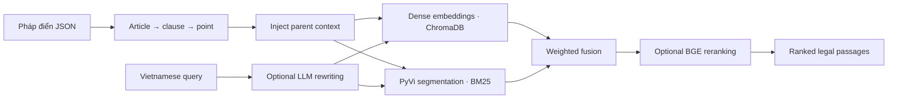

# Vietnamese Legal RAG

A retrieval engine for Vietnamese legal question answering. It indexes the Vietnamese legal codification corpus (Pháp điển), then returns ranked legal passages for an agentic RAG chatbot.

**FPT Smart Cloud · AI Engineer Intern · Hanoi, Vietnam · June–September 2026**

## Internship results

Replacing article-level chunks with recursive, structure-aware chunks and injecting their parent context raised **Recall@10 from approximately 87% to 96.9%**. I then built a hybrid retriever and used a coarse-to-fine Optuna search to tune BM25 term saturation, document length normalization, and the dense/sparse fusion weight.

| Metric | Tuned hybrid retrieval |
| --- | ---: |
| Recall@1 | **80.2%** |
| Recall@3 | **92.5%** |
| Recall@10 | **98.6%** |
| Precision@10 | **91.4%** |

These results come from the internship evaluation across **8,238 benchmark queries**. The checkout includes a benchmark runner that takes a separate question set and relevance mapping. Historical benchmark report ([English](docs/benchmark-report.en.md) · [Tiếng Việt](docs/benchmark-report.md)).

## How retrieval works



- **Structure-aware chunking.** Recursively splits long articles along their clauses and points and retains hierarchical context so a passage can be interpreted in relation to its parent article.
- **Hybrid retrieval.** Dense embeddings capture semantic matches. BM25 adds lexical matches using PyVi segmentation at both index and query time, so phrases such as `giấy phép` can be matched as compound terms.
- **Query rewriting.** An optional LLM rewrites noisy, abbreviated, and conversational Vietnamese into concise legal search queries. Local normalization provides a fallback when the model request fails or returns unusable output.
- **Retrieval tuning.** Optuna searches a coarse grid, then samples around the best region to tune `k1`, `b`, and the sparse fusion weight. The tuner reuses the tokenized corpus and query embeddings across trials.

## Run locally

Use Python 3.10 or later. Run commands from the repository root.

```bash
python -m pip install -r rag_pipeline/requirements.txt
```

The checked-in configuration uses FPT Cloud embeddings and BGE reranking. Set these variables before running it.

| Environment variable | Used by |
| --- | --- |
| `FPT_API_KEY` | API embeddings and optional LLM rewriting |
| `FPT_RERANKER_API_KEY` | BGE reranking when enabled |

The included 45-topic JSON corpus is sourced from Vietnam’s publicly available Pháp điển codification. Build the index from `data/phap_dien_dataset_45_chu_de/` before searching. [Ministry of Justice Pháp điển portal](https://phapdien.moj.gov.vn/Pages/chi-tiet-bo-phap-dien.aspx)

```bash
python -m rag_pipeline.cli.main -c rag_pipeline/config.yaml index
python -m rag_pipeline.cli.main -c rag_pipeline/config.yaml search "thủ tục đấu giá tài sản"
```

To enable LLM rewriting, set `query_rewriter.enabled: true` and `query_rewriter.mode: llm` in `rag_pipeline/config.yaml`. This sends query text to the configured API. Use `mode: rules` for local normalization or `search --raw` to bypass rewriting on a single query.

## Evaluate and tune

Supply the benchmark question JSON and the article-to-benchmark ID mapping. The example filenames below are local inputs. Use `--rechunk` when you change the corpus, mapping, or chunking settings.

```bash
python -m rag_pipeline.cli.benchmark --config rag_pipeline/config.yaml --questions benchmarks/input/1238_question_map_phap_dien.json --id-map "benchmarks/input/Correct ID.json"
```

Use a labeled tuning split for Optuna. The tuner scores weighted hybrid retrieval before reranking and selects by the fraction of queries with a relevant result in the top 10.

```bash
python -m rag_pipeline.cli.benchmark --config rag_pipeline/config.yaml --questions benchmarks/input/tuning_questions.json --id-map "benchmarks/input/Correct ID.json" --tune-bm25 --fine-trials 25
```

Copy the winning `bm25` parameters from `benchmarks/results/bm25_tuning.json` into the config and run the benchmark on held-out questions. Set `reranker.enabled: false` to evaluate the same ranking stage the tuner optimizes.

## Repository layout

| Path | Contents |
| --- | --- |
| `rag_pipeline/cli/` | Index, search, benchmark, and tuning entry points |
| `rag_pipeline/indexing/` | Chunking, context injection, embeddings, and ChromaDB storage |
| `rag_pipeline/retrieval/` | PyVi/BM25, query rewriting, fusion, and reranking |
| `rag_pipeline/config.yaml` | Pipeline settings |
| `data/phap_dien_dataset_45_chu_de/` | Public-source Pháp điển corpus grouped by topic |
| `docs/` | Historical benchmark analysis in English and Vietnamese |
| `artifacts/`, `benchmarks/results/` | Generated indexes, caches, and evaluation output |

[License](LICENSE)
